# FinSense 💸
### Autonomous Forecast-Driven Financial Operating System & Predictive Copilot

[](https://www.python.org/)
[](https://pytorch.org/)
[](https://fastapi.tiangolo.com/)
[](https://reactjs.org/)
[](https://threejs.org/)
[](https://vitejs.dev/)
[](file:///Users/ms/Desktop/FinSense/scripts/run_all_tests.py)
[](https://opensource.org/licenses/MIT)

---

FinSense is a state-of-the-art **autonomous personal finance intelligence platform** built to fundamentally surpass legacy backward-looking trackers like Rocket Money, Copilot Money, and Monarch. While traditional fintech apps merely display static charts of where your money already went, FinSense combines **deep temporal time-series forecasting, bottleneck autoencoders, graph neural networks (GraphSAGE), and contextual multi-armed bandits** to deliver forward-looking financial autonomy with **zero arithmetic hallucinations**.

---

## 🧭 The 5 Foundational Questions of Personal Finance

FinSense is engineered around answering the five questions every individual has about their money:

| # | Foundational Question | Core Capability | Technological Engine |
|---|---|---|---|
| **1** | **What happened to my money?** | Real-Time Normalized Ledger & Spend Pacing | Scale-invariant log-transform feature extraction & internal transfer deduplication |
| **2** | **Why is it happening?** | 4-Pillar Health Score & Anomaly Detection | Equal-weight financial diagnostic + Dual-Tier Autoencoder & Isolation Forest consensus |
| **3** | **What is likely to happen next?** | Discretionary Spending & Cash-Flow Forecast | Bidirectional `SpendingLSTM` + Temporal Convolutional Network (`TCNForecaster`) |
| **4** | **What should I do right now?** | Contextual Action Personalization | `LinUCB` Contextual Multi-Armed Bandit + Rule-based Safety Guardrails |
| **5** | **What if I make a different decision?** | Forward Counterfactual Scenario Engine | Multi-month trajectory balance simulator & DTI affordability calculator |

---

## 🏛️ System Architecture & Engineering Blueprint

FinSense integrates raw financial data ingestion, deep learning models, mathematical state fusion, and a luxury executive cockpit frontend.

```mermaid
flowchart TD
    subgraph INGESTION["1. Financial Ingestion Layer"]
        A1["Open Banking Sync<br/>(Setu Account Aggregator / Plaid)"]
        A2["Multi-Format Statement Dropzone<br/>(CSV / TSV / PDF Parser)"]
        A3["Sandboxed Demo Mode<br/>(Sample Student ICICI Profile)"]
    end

    subgraph DATA_ENGINEERING["2. Data Engineering & Feature Store"]
        B1["Transaction Normalization & Deduplication<br/>(Exclude SIPs, CC settlements, transfers)"]
        B2["Scale-Invariant Feature Pipeline<br/>(log1p scaling, shock ratios, temporal windows)"]
        B3["User-Scoped Storage Isolation<br/>(FINSENSE_USER_LEDGER_${email})"]
    end

    subgraph MODELS["3. Machine Learning & Deep Learning Core"]
        C1["SpendingLSTM & TCN<br/>Temporal Spend Forecaster"]
        C2["FinancialAutoencoder<br/>Reconstruction Loss"]
        C3["AnomalyIsolationForest<br/>Contamination Scoring"]
        C4["FinancialGraphSAGE<br/>Latent Peer Embeddings"]
        C5["LinUCB Bandit<br/>Recommendation Ranking"]
    end

    subgraph FUSION["4. Unified Financial Calculation Engine"]
        D1["Reconciled Mathematical State<br/>(True Safe-to-Spend, Spend Pacing, Total Cash)"]
        D2["4-Pillar Health Score (0–100)<br/>(Income, Cushion, Anomaly, Debt)"]
        D3["Subscription Recurrence Radar<br/>(Interval clustering & price creep)"]
    end

    subgraph SERVING["5. Presentation & Copilot Interface"]
        E1["FastAPI 12-Router REST Microservice<br/>(Uptime monitoring, Swagger /docs)"]
        E2["Executive Cockpit React 18 Frontend<br/>(Editorial Light & Obsidian Dark)"]
        E3["Interactive WebGL 3D Galaxy<br/>(Peer Twin Visualization)"]
        E4["Zero-Hallucination AI Copilot<br/>(Grounded in verified financial ledger)"]
    end

    INGESTION --> DATA_ENGINEERING
    DATA_ENGINEERING --> MODELS
    MODELS --> FUSION
    FUSION --> SERVING
```



---

## ⚡ Core Features & Capabilities

### 1. Rocket Money–Grade Executive Cockpit
- **True Safe-to-Spend Today**: Calculates guaranteed guilt-free spending limit today with zero risk of missing upcoming bills:
  $$\text{Safe-to-Spend} = \max\Big(0, \text{Checking Cash} - \text{Upcoming Bills}_{\text{14d}} - \text{Safety Buffer}_{\text{floor}} - \text{Budget Constraint}\Big)$$
- **Constrained Recovery Mode**: If monthly living spend exceeds target pacing, automatically switches into constrained mode, showing the exact daily cutback needed to restore safety reserves by month-end.
- **Strict Spend Deduplication**: Completely eliminates false spending spikes by filtering out internal bank transfers, credit card debt settlements, and capital investments (e.g., Zerodha equity SIPs).
- **Explain This Metric Inspector Drawer**: Slide-over modal detailing mathematical formula, weight distribution, and primary ledger drivers.

### 2. Equal-Weight 4-Pillar Money Health Score
Unlike arbitrary credit scores, FinSense computes a comprehensive 0–100 Money Health Score balanced equally across 4 key financial pillars (25% weight each):
1. **Steady Income vs. Bills (25%)**: Inflow coverage ratio against fixed recurring commitments.
2. **Emergency Savings Cushion (25%)**: Liquid savings runway calculated dynamically against monthly essential burn.
3. **Protection from Surprise Expenses (25%)**: Buffer insulation against anomalous spending spikes.
4. **Manageable Monthly Commitments (25%)**: Share of income claimed by recurring obligations.

### 3. Frictionless 3-Channel Ingestion & Clean-Slate Onboarding
- **Instant Bank Sync**: Real-time integration via RBI-regulated Setu Account Aggregator and Plaid delta sync for HDFC, ICICI, SBI, Axis, Kotak, and Chase.
- **Universal Statement Dropzone**: Automatic delimiter detection, credit/debit column mapping, and timestamp parsing for CSV, TSV, and PDF bank exports.
- **Test-Drive Demo Sandbox**: Instant 1-click exploration with a realistic sample student portfolio.
- **Clean Slate Isolation**: New accounts start with zero data leakage (`hasImportedData: false`), displaying an interactive Onboarding Action Center rather than dummy balances.

### 4. Recurring Bills Radar & Subscription Commander
- **Algorithmic Cadence Detection**: Clusters debit intervals into Weekly, Monthly, Quarterly, and Annual cadences.
- **Silent Price-Creep Detection**: Flags stealth price increases (e.g., Netflix hike from ₹499 to ₹649 or gym hike from ₹1,299 to ₹1,499).
- **Redundancy & Overlap Alerts**: Identifies duplicate subscriptions in the same category (e.g., multiple concurrent streaming services).
- **1-Click Cancellation Playbooks**: Direct merchant account settings deep-links and step-by-step instructions for revoking linked UPI auto-pay e-mandates.

### 5. Dual-Tier Consensus Anomaly Guard
- Evaluates transactions via a two-tier consensus model:
  $$\text{Anomaly Consensus} = \Big(\mathcal{L}_{\text{Autoencoder}}(\mathbf{x}) > \tau_{\text{AE}}\Big) \wedge \Big(\mathcal{S}_{\text{IsoForest}}(\mathbf{x}) > \tau_{\text{IF}}\Big)$$
- Distinguishes legitimate one-off capital expenses (e.g. college semester tuition) from suspicious behavioral anomalies.
- Human-in-the-loop review interface with instant verification and celebratory feedback.

### 6. Interactive 3D Peer Universe (Financial Twins)
- Powered by **`FinancialGraphSAGE`**, an inductive Graph Neural Network that maps users into an embedding space based on cash-flow topology and behavioral habits.
- Rendered in interactive WebGL with **Three.js** and `@react-three/fiber`:
  - Explore your position within peer clusters (*Conservative Savers*, *Discretionary Builders*, *Debt Accelerators*).
  - Simulate behavioral trajectories to benchmark against top savers in your life stage.

### 7. Smart Autopilot Sweep Engine
- Calculates surplus cash above a 14-day essential liquidity buffer.
- Simulates automated micro-sweeps to high-yield reserve accounts.
- Features a **52-Week Backtesting Engine** demonstrating compounded interest yield generated without ever incurring an overdraft.

### 8. Affordability Simulator & Scenario Engine
- Real-time counterfactual simulation for major purchases, emergency shocks, or career changes:
  - *"Can I afford a ₹45,000 MacBook?"*
  - *"What happens to my runway if my rent increases by ₹3,000/month?"*
  - *"Simulate an 8-month sabbatical with zero active income."*
- Projects forward cash-flow trajectories up to 90 days with debt-to-income (DTI) stress testing.

### 9. Zero-Hallucination AI Financial Assistant (Copilot)
- Multi-provider LLM conversational copilot (Claude 3.5 Sonnet / GPT-4o / Local SLM).
- Strict prompt isolation: The LLM is **never permitted to do mental math**. All metrics, safe-to-spend limits, and balances are injected directly from the deterministic financial calculation engine.

---

## 🧠 Machine Learning & Algorithmic Specifications

| Model / Algorithm | Class Name | Input Features | Objective / Loss Function | Production Role |
|---|---|---|---|---|
| **Deep Temporal Forecaster** | [`SpendingLSTM`](file:///Users/ms/Desktop/FinSense/src/models/lstm.py) | 12-week sequence $\times$ 10 features (categories, velocity, sin/cos week) | Smooth L1 (Huber) Loss with Non-Negative ReLU projection | Multi-category discretionary spending forecasts |
| **Dilated Causal Forecaster** | [`TCNForecaster`](file:///Users/ms/Desktop/FinSense/src/models/tcn_forecaster.py) | Dilated causal residual blocks (receptive field = 16 weeks) | Mean Squared Error (MSE) | Long-horizon temporal sequence modeling |
| **Bottleneck Autoencoder** | [`FinancialAutoencoder`](file:///Users/ms/Desktop/FinSense/src/models/autoencoder.py) | Normalized financial feature vectors ($D = 14 \to 6 \to 14$) | Reconstruction Loss: $\mathcal{L}_{\text{recon}} = \|\mathbf{x} - \hat{\mathbf{x}}\|^2_2$ | Unsupervised behavioral deviation detection |
| **Isolation Forest** | [`AnomalyIsolationForest`](file:///Users/ms/Desktop/FinSense/src/models/isolation_forest.py) | Transaction amount, z-score, velocity, and merchant risk factor | Average path length in ensemble of 100 random isolation trees | Rapid contamination scoring |
| **Inductive Graph GNN** | [`FinancialGraphSAGE`](file:///Users/ms/Desktop/FinSense/src/models/graphsage.py) | User-node demographic features + Transaction edge graph | Unsupervised GraphSAGE neighborhood aggregation loss | Latent peer twin discovery & 3D galaxy |
| **Contextual Bandit** | [`LinUCBContextualBandit`](file:///Users/ms/Desktop/FinSense/src/models/contextual_bandit.py) | User financial context vector $\mathbf{x} \in \mathbb{R}^8$ | Upper Confidence Bound: $a^* = \arg\max_a (\mathbf{x}^\top \hat{\theta}_a + \alpha \sqrt{\mathbf{x}^\top A_a^{-1} \mathbf{x}})$ | Dynamic financial action prioritization |
| **Persona Classifier** | [`PersonaMLP`](file:///Users/ms/Desktop/FinSense/src/models/persona_mlp.py) | Income, savings rate, burn velocity, DTI, credit health | Multi-class Cross-Entropy Loss | Behavioral persona segmentation |

---

## 📁 Repository Anatomy

```
FinSense/
├── app/
│   ├── main.py                      # FastAPI microservice entrypoint & router assembly
│   ├── schemas.py                   # Canonical Pydantic API request/response schemas
│   ├── api/                         # 12 Modular REST Routers
│   │   ├── health_score.py          # 4-Pillar composite score & diagnostics
│   │   ├── forecast.py              # 7/14/30/90-day multi-category spending predictions
│   │   ├── subscriptions.py         # Recurrence detection, price hikes, cancellation
│   │   ├── autopilot.py             # Smart sweep evaluation & 52-week backtesting
│   │   ├── scenarios.py             # What-if trajectory simulation & affordability
│   │   ├── recommendations.py       # Contextual bandit recommendation ranker
│   │   ├── twins.py                 # GraphSAGE peer twin benchmarking & 3D galaxy
│   │   ├── ingestion.py             # Plaid & Setu AA sync, statement upload, webhook
│   │   ├── assistant.py             # Zero-hallucination AI copilot endpoint
│   │   ├── anomalies.py             # Dual-tier anomaly alerts & feedback loop
│   │   ├── graph.py                 # Contagion dynamics & graph topology
│   │   └── features.py              # Scale-invariant feature explorer
│   ├── services/
│   │   └── model_registry.py        # Thread-safe singleton model registry & warm-up
│   └── frontend/                    # Modern Vite + React 18 SPA
│       ├── src/
│       │   ├── App.jsx              # Main shell orchestrating landing, auth & cockpit
│       │   ├── components/          # 20+ High-performance financial cockpit components
│       │   │   ├── SafeToSpendHero.jsx       # True Safe-to-Spend & Spend Pacing
│       │   │   ├── HealthHero.jsx            # Radial 4-Pillar Health Scorecard
│       │   │   ├── RecentActivityLedger.jsx  # Interactive ledger & account tiles
│       │   │   ├── SubscriptionCommander.jsx # 30-day bill calendar & 1-click cancel
│       │   │   ├── AnomalyGuardModule.jsx    # Anomaly alerts & consensus approval
│       │   │   ├── PeerUniverse3D.jsx        # Three.js 3D WebGL Peer Universe
│       │   │   ├── AutopilotHub.jsx          # Safe sweep & savings simulator
│       │   │   ├── AffordabilitySimulator.jsx# Loan & purchase stress testing
│       │   │   ├── ConnectBankModal.tsx      # Rocket Money 3-channel ingestion modal
│       │   │   └── onboarding/               # Zero-state Onboarding Action Center
│       │   ├── store/
│       │   │   ├── financeStore.js           # User-scoped reactive financial store
│       │   │   └── authStore.js              # Authentication & session isolation
│       │   └── utils/
│       │       ├── financeEngine.js          # Deterministic single source of truth math
│       │       └── transactionNormalizer.ts  # Standardized transaction schema mapping
├── src/
│   ├── data/                        # Ingestion, cleaning, validation & SQL pipelines
│   ├── preprocessing/               # Log1p scaling, sliding windows, graph builder
│   ├── models/                      # PyTorch neural forecasters, autoencoders, bandits
│   ├── intelligence/                # Recurrence engine, autopilot sweep, financial state
│   ├── scenarios/                   # Affordability engine & forward balance simulator
│   ├── ai/                          # Intent classifier, context builder, copilot narrator
│   └── evaluation/                  # RMSE, WAPE, Directional Accuracy, Jaccard consensus
├── data/                            # Raw, interim, and processed data directories
├── docs/
│   ├── ALGORITHMS.md                # Mathematical formulations & proof blueprints
│   ├── ARCHITECTURE.md              # System architecture & component data flows
│   └── PROJECT_LEARNING_NOTES.md    # Walkthrough & defense notes
├── scripts/
│   └── run_all_tests.py             # Master test suite runner executing all 20 suites
├── tests/                           # Complete pytest & unit verification suite
├── run_api.sh                       # One-click backend launcher
└── run_dashboard.sh                 # One-click frontend launcher
```

---

## 🚀 Quickstart & Installation Guide

### Prerequisites
- **Python**: `>= 3.10`
- **Node.js**: `>= 18.0` & `npm >= 9.0`
- **Operating System**: macOS, Linux, or Windows WSL2

---

### Step 1: Clone the Repository
```bash
git clone https://github.com/YourUsername/FinSense.git
cd FinSense
```

---

### Step 2: Backend Setup (FastAPI & PyTorch Core)
```bash
# 1. Create and activate a clean virtual environment
python3 -m venv .venv
source .venv/bin/activate

# 2. Install Python dependencies
pip install --upgrade pip
pip install -r requirements.txt

# 3. Configure environment variables
cp .env.example .env
# Edit .env to add your optional OpenAI or Anthropic API keys for natural language features
```

---

### Step 3: Frontend Setup (Vite + React Cockpit)
```bash
cd app/frontend
npm install
cd ../..
```

---

### Step 4: Launch FinSense

You can launch both services using the provided one-click scripts or manual commands:

#### Option A: One-Click Shell Scripts
In Terminal 1 (Backend API):
```bash
./run_api.sh
```

In Terminal 2 (Frontend Dashboard):
```bash
./run_dashboard.sh
```

#### Option B: Manual Launch
```bash
# Terminal 1: FastAPI Service (runs on http://localhost:8000)
source .venv/bin/activate
env PYTHONPATH=. python -B app/main.py

# Terminal 2: Vite React Dev Server (runs on http://localhost:5173)
cd app/frontend
npm run dev
```

- **Interactive Executive Cockpit**: [`http://localhost:5173`](http://localhost:5173)
- **Interactive Swagger API Docs**: [`http://localhost:8000/docs`](http://localhost:8000/docs)
- **Alternative ReDoc API Docs**: [`http://localhost:8000/redoc`](http://localhost:8000/redoc)

---

## 🧪 Comprehensive Verification Matrix (20/20 Passing)

FinSense includes a master test runner executing 20 unit, statistical, and integration test suites covering every component of the system:

```bash
env PYTHONPATH=. python -B scripts/run_all_tests.py
```

```
======================================================================
🚀 RUNNING COMPLETE FINSENSE ALGORITHM & SYSTEM TEST SUITE
======================================================================

▶ Testing: tests/test_data.py                    ✅ PASSED
▶ Testing: tests/test_features.py                ✅ PASSED
▶ Testing: tests/test_sequences.py               ✅ PASSED
▶ Testing: tests/test_lstm.py                    ✅ PASSED
▶ Testing: tests/test_tcn.py                     ✅ PASSED
▶ Testing: tests/test_forecasting.py             ✅ PASSED
▶ Testing: tests/test_autoencoder.py             ✅ PASSED
▶ Testing: tests/test_isolation_forest.py        ✅ PASSED
▶ Testing: tests/test_contextual_bandit.py       ✅ PASSED
▶ Testing: tests/test_persona_mlp.py             ✅ PASSED
▶ Testing: tests/test_graphsage.py               ✅ PASSED
▶ Testing: tests/test_financial_state.py         ✅ PASSED
▶ Testing: tests/test_recommendations.py         ✅ PASSED
▶ Testing: tests/test_scenarios.py               ✅ PASSED
▶ Testing: tests/test_subscription_detector.py   ✅ PASSED
▶ Testing: tests/test_autopilot_savings.py       ✅ PASSED
▶ Testing: tests/test_ingestion.py               ✅ PASSED
▶ Testing: tests/test_api.py                     ✅ PASSED
▶ Testing: tests/test_ai_assistant.py            ✅ PASSED
▶ Testing: tests/test_full_pipeline.py           ✅ PASSED

======================================================================
🎉 ALL 20 TEST SUITES COMPLETED WITH ZERO FAILURES!
======================================================================
```

---

## 📡 REST API Reference

FinSense exposes a production-ready REST API documented with OpenAPI 3.0:

| Method | Endpoint | Description |
|---|---|---|
| `GET` | `/health` | Service health check, uptime & model registry status |
| `GET` | `/api/v1/health` | 4-Pillar Money Health Score, pillar breakdown & persona diagnostic |
| `POST` | `/api/v1/forecast` | Generates 7/14/30/90-day multi-category spending predictions |
| `GET` | `/api/v1/subscriptions` | Recurrence radar, interval cadences, price hikes, and overlapping services |
| `POST` | `/api/v1/subscriptions/detect` | Runs recurrence detection over raw transaction arrays |
| `GET` | `/api/v1/anomalies` | Two-tier consensus anomalies with reconstruction error scores |
| `POST` | `/api/v1/anomalies/feedback` | Human-in-the-loop verification and resolution |
| `POST` | `/api/v1/autopilot/evaluate` | Evaluates safe sweep surplus and buffer requirements |
| `POST` | `/api/v1/autopilot/backtest` | Executes 52-week historical simulation of micro-sweeps |
| `POST` | `/api/v1/scenarios/afford` | DTI stress testing for large discretionary purchases & loans |
| `POST` | `/api/v1/scenarios/simulate` | Multi-month forward cash-flow trajectory simulation |
| `GET` | `/api/v1/twins/galaxy_3d` | GraphSAGE 3D coordinate embeddings for WebGL peer visualization |
| `POST` | `/api/v1/recommendations/rank` | `LinUCB` contextual bandit ranking of prioritized actions |
| `POST` | `/api/v1/ingestion/upload` | Ingests raw CSV/TSV/PDF bank statements with auto-delimiter detection |
| `POST` | `/api/v1/ingestion/plaid/sync` | Executes Plaid webhook delta ingestion |
| `POST` | `/api/v1/ingestion/aa/sync` | Executes RBI-regulated Setu Account Aggregator sync |
| `POST` | `/api/v1/assistant/chat` | Zero-hallucination natural language AI copilot dialogue |

---

## 🏆 Competitive Benchmark: FinSense vs. Traditional Apps

| Dimension | Legacy Apps (Mint / Rear-View Trackers) | Rocket Money / Copilot Money | FinSense AI Operating System |
|---|---|---|---|
| **Spending Intelligence** | Lagging pie charts of historical spend | Fixed monthly budget category bars | **`SpendingLSTM` deep sequence forecaster**: Predicts spend 1–4 weeks ahead in dollar space. |
| **Safe-to-Spend Metric** | None (calculates only cash balance) | Simple linear daily divide ($Balance / DaysLeft$) | **Mathematically Reconciled Safe-to-Spend**: Reserves 14-day bills and buffer floors with Constrained Recovery Mode. |
| **Subscription Tracking** | Keyword matching on transaction names | Identifies recurring debits | **Recurrence Radar**: Detects silent price creep (+₹150 hikes), redundancy overlaps, and 1-click cancellation guides. |
| **Anomaly Guard** | Static thresholds (e.g. alert if $> \$100$) | Basic merchant alerts with high false positives | **Dual-Tier Consensus (`Autoencoder` + `IsolationForest`)**: Distinguishes structural behavioral shifts from noise. |
| **Action Recommendations** | Generic affiliate credit card advertisements | Static rule cards | **`LinUCB` Contextual Bandit**: Recommends actions personalized to your real-time DTI and runway. |
| **Peer Benchmarking** | Static national averages | None | **`FinancialGraphSAGE` 3D Galaxy**: Discovers latent financial twins in your exact life stage via WebGL. |
| **Decision Stress Testing** | None | Simple static loan calculator | **Forward Scenario Engine**: Counterfactual balance simulations for sabbaticals, rent hikes, or major purchases. |
| **Onboarding Clean Slate** | N/A | Dummy data leaks or forced bank link | **Clean Slate Zero-State**: User-scoped storage isolation with Setu AA, statement dropzone, or demo sandbox. |

---

## 🔒 Security, Privacy & Responsible AI

- **User-Scoped Storage Isolation**: Client sessions are strictly keyed by authenticated user (`FINSENSE_USER_LEDGER_${email}`). Switching accounts cleanly isolates all ledger data with zero cross-tenant leakage.
- **Zero Arithmetic Hallucination**: The AI Copilot is strictly prohibited from computing figures. All financial balances, health scores, and runway forecasts are derived from deterministic Python/TypeScript calculation engines.
- **Data Privacy**: FinSense does not sell user transaction histories or display intrusive credit card advertisements. Ingestion is fully compatible with privacy-first open banking standards (ReBIT AA and Plaid).

---

## 📄 License

Distributed under the **MIT License**. See `LICENSE` for more information.

---

<div align="center">
  <sub>Engineered with precision for the future of personal financial autonomy. Built with FastAPI, PyTorch, React, and Three.js.</sub>
</div>
